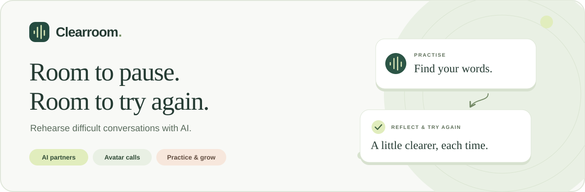
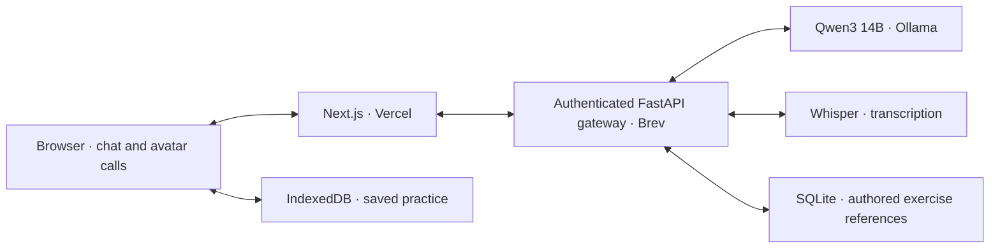

<div align="center">

<a href="https://clearroom-beta.vercel.app/">
  
</a>

**A little rehearsal for the conversations that matter.**

[**🌿 Open the live project →**](https://clearroom-beta.vercel.app/) · [Source code](https://github.com/darau77/clearroom) · [Setup guide](docs/TECHNICAL_GUIDE.md#local-development)

**AI partners** · **Animated avatar calls** · **Personalized reflections** · **Practice trophies**

</div>

---

## Meet Clearroom

The conversation you keep putting off deserves a practice run. Clearroom gives you a place to rehearse it with an AI partner, reflect on your words, and try another approach.

Practise giving feedback, setting a boundary, handling disagreement, or asking for what you need. Start with a ready-made scenario or create a fictional partner for your own situation—at work, with a friend, or at home.

**Live project: [clearroom-beta.vercel.app](https://clearroom-beta.vercel.app/)**

Open it directly. No visitor account or sign-in is required.

## ✨ Two ways to practise

| Have the conversation | Build the habit |
| --- | --- |
| Chat with an AI partner who responds to your situation. | Follow six skill units across 24 guided lessons. |
| Join an animated avatar call with captions and spoken replies. | Fill missing words, build sentences, choose responses, and write your own. |
| Create a partner's role, relationship, personality, and goal. | Earn XP, work toward daily goals, and unlock bronze, silver, and gold trophies. |
| Finish a chat or call to get a reflection grounded in the transcript. | Ask Qwen for new variations in all four exercise modes. |

### Practice that grows with you

The course starts with **120 original questions** covering observations, curiosity, empathy, boundaries, agreements, and repair. Each unit moves from **missing words → choosing a response → building a sentence → writing in your own words**.

- **A bank to build on.** Questions rotate by skill, level, and what you have already seen. Qwen retrieves examples from the same bank to create variations for your selected partner and situation.
- **A second chance to remember.** Missed questions and answers completed with hints return after the other questions. Later review prioritizes difficult and due material.
- **Meaningful writing.** Connected writing practice uses Qwen to assess the response against a specific goal. An explicit self-review option keeps practice available when AI is unavailable.
- **A guide beside you.** Your selected partner appears as an animated practice guide, with optional original sound cues and a completion celebration.

See [how questions are authored, selected, and checked](docs/PRACTICE_DESIGN.md).

### A conversation worth trying

1. **Choose your partner.** Meet Alex, Jordan, or Sam—or create someone for the conversation you want to rehearse.
2. **Set the scene.** Pick your goal, difficulty, and language.
3. **Talk it through.** Use text chat or an avatar call. Review voice transcripts before sending them.
4. **Reflect and return.** See what worked, a useful refinement, and an example that demonstrates it. Revisit the full report in **My progress**.

Your drafts are resumable, progress synchronizes across tabs, and optional memory can carry context into later sessions with the same partner.

## 💬 Coaching that uses your conversation

Clearroom's Qwen backend generates the partner's opening and replies from the situation and conversation history. It checks character roles, task ownership, requested language, and repeated replies before returning dialogue.

Reports for **both chats and avatar calls** include:

- **What to build on:** strengths supported by your own words.
- **A useful refinement:** checked against the whole transcript, including the final turn.
- **Another way to say it:** your intent preserved, with the suggested action demonstrated in the rewrite.
- **An honest acknowledgment:** when no additional gap is verified, the report recognizes what you already did well.

These checks reduce mistakes; AI feedback can still be imperfect. Coaching uses the transcript, rather than judging facial expressions or vocal delivery.

## 🛠️ Built with

| Layer | Technology |
| --- | --- |
| Web app | Next.js 16 · React 19 · TypeScript |
| AI gateway | Python · FastAPI |
| Conversation model | Qwen3 14B, Q4_K_M · Ollama |
| Voice | Multilingual Whisper `small` · browser/device speech synthesis |
| Progress | IndexedDB · BroadcastChannel |
| Exercise bank | Versioned JSON · SQLite reference database |
| Hosting | Vercel for the website · NVIDIA Brev with a 16 GB T4 for inference |

<details>
<summary><strong>See how the pieces fit together</strong></summary>



The browser calls the Next.js server, which keeps the backend key private. Qwen generates dialogue, coaching, and checked exercise variations; Whisper transcribes recordings. The same authored question bank powers immediate browser practice and the server's reference database. Speech playback uses available device voices, and the optional camera preview stays on the device.

</details>

## 🚀 Run locally

Use **Node.js 22.13+**; Node.js 24 is recommended.

```sh
git clone https://github.com/darau77/clearroom.git
cd clearroom
npm ci
npm run dev
```

Open [localhost:3000](http://localhost:3000).

To connect an existing inference backend, create an ignored `.env.local` file in the project root:

```dotenv
BREV_API_URL=https://your-backend-origin.example
BREV_API_KEY=your-private-backend-key
```

These are **server-only** values. Without a connected backend, the app shows an explicit AI-unavailable state; the authored practice drills remain usable without AI.

For GPU setup, Vercel deployment, and troubleshooting, follow the [technical guide](docs/TECHNICAL_GUIDE.md).

### Checks

```sh
npm run lint
node --test tests/*.test.mjs
npm run build
```

Backend tests run without a GPU or model download; see the [backend test setup](docs/TECHNICAL_GUIDE.md#backend-tests-without-gpu-or-model-download). Real model and microphone checks are separate from the mocked test suite.

## 📁 Find your way around

```text
clearroom/
├── app/           Pages, styles, and server API routes
├── components/    Partners, avatar calls, lessons, and reports
├── lib/           Practice state, rewards, storage, and browser voice
├── backend/       Qwen gateway, transcription, checks, and deployment
├── tests/         Frontend logic tests
├── public/        Public assets
└── docs/          Technical guide and README artwork
```

## 🌱 Current scope

Clearroom is a working prototype. Avatar calls are turn-based: **record → review → send → listen**. Voices depend on the device, and automatic interruptions are a future improvement. The maintained question bank is currently in English; optional Qwen variations use the selected language and situation. Exercise checks and review intervals support practice, but do not measure real-world communication ability. Rewards celebrate effort, and self-reviewed writing is labeled separately from AI-checked work.

Progress is saved in this browser and shared across its tabs, rather than across devices. Live text and recordings are processed through Vercel and Brev. Live AI also depends on the Brev server being available and has shared usage limits. The [data and privacy notes](docs/TECHNICAL_GUIDE.md#data-and-privacy) explain the details.

## 📖 Go deeper

- [Question creation, Qwen variations, and spaced review](docs/PRACTICE_DESIGN.md)
- [Custom partners and practice trails](docs/TECHNICAL_GUIDE.md#custom-partners-and-practice-trail)
- [Rewards and progression](docs/TECHNICAL_GUIDE.md#practice-rewards)
- [Deploy the public website](docs/TECHNICAL_GUIDE.md#deploy-the-public-website-on-vercel)
- [Launch the Qwen backend](docs/TECHNICAL_GUIDE.md#launch-the-inference-backend-on-brev)
- [Connect the website and backend](docs/TECHNICAL_GUIDE.md#connect-the-website)
- [Next milestones](docs/TECHNICAL_GUIDE.md#next-milestones)

## 📜 License

Clearroom's original code is available under the [MIT License](LICENSE). Dependencies, model weights, fonts, and vendored components retain their own licenses; see [third-party notices and license inventory](THIRD_PARTY_NOTICES.md).

---

<div align="center">

**Room to pause. Room to try again.**

[**Start a conversation →**](https://clearroom-beta.vercel.app/)

</div>
